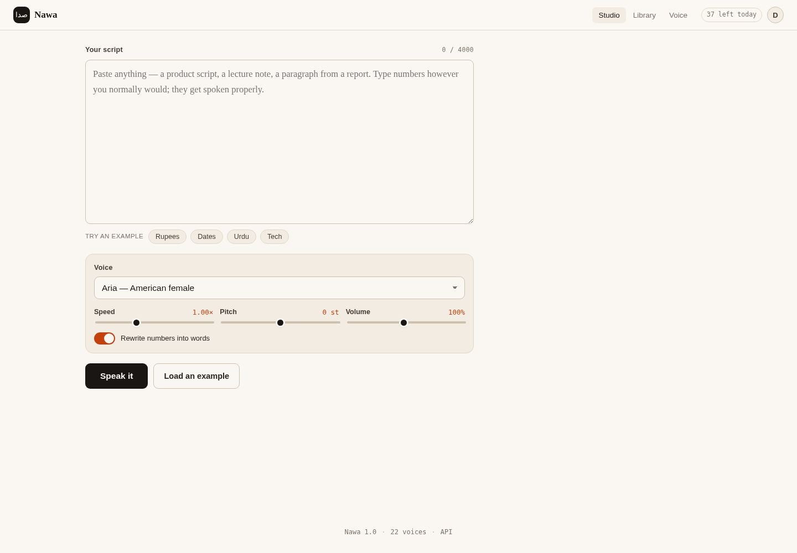
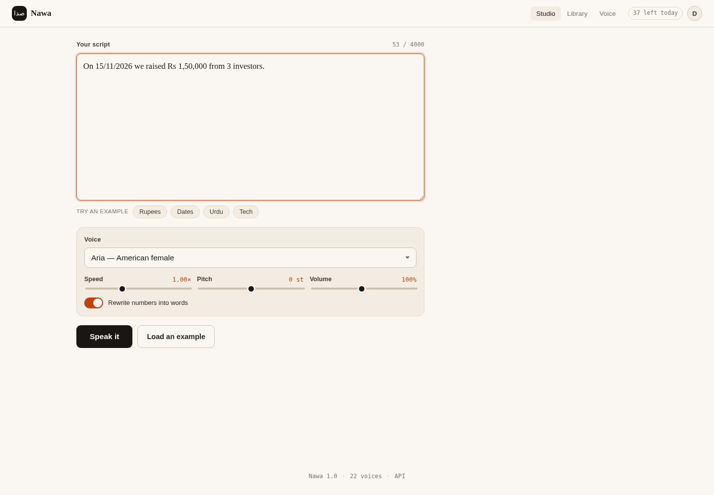
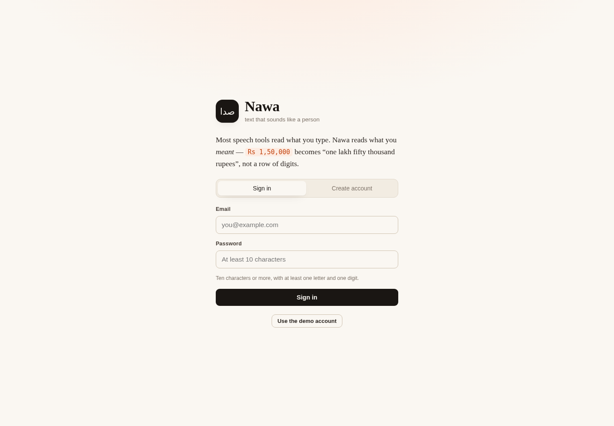
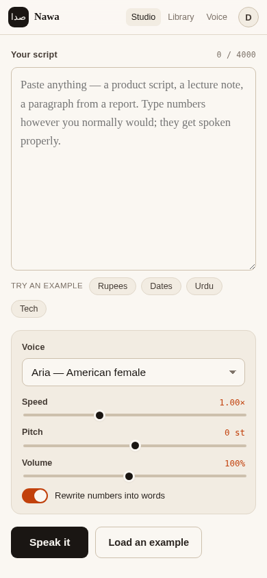

# Nawa

**Text-to-speech that says numbers the way people actually say them.**

[](https://www.python.org/)
[](https://fastapi.tiangolo.com/)
[](#tests)
[](https://github.com/astral-sh/ruff)
[](LICENSE)

---

## The problem

Every text-to-speech tool reads what you paste. Paste a business script and it
says:

> "R S one comma five zero comma zero zero zero"

Paste a date and it says "fifteen slash eleven slash two thousand and twenty
six". Paste a phone number and it reads it as one enormous integer.

The audio is fine. The text going in was never speakable.

Nawa fixes the text first.

| You type | It says |
|---|---|
| `Rs 1,50,000` | one lakh fifty thousand rupees |
| `$2.5 million` | two point five million dollars |
| `15/11/2026` | the fifteenth of November twenty twenty-six |
| `18%` | eighteen percent |
| `09:30 AM` | nine thirty a m |
| `0300-1234567` | zero three zero zero one two three four five six seven |
| `3rd` | third |
| `in 2026` | in twenty twenty-six |
| `1000 days` | one thousand days |

That last pair is the interesting one. Both are four digits. One is a year, one
is a count, and they are read differently. Nawa looks at the surrounding words
to decide.

## Screenshots

| Studio | The rewrite, shown before you spend a call |
|---|---|
|  |  |

| Sign in | Mobile |
|---|---|
|  |  |

## Features

**The text pipeline**
- Numbers, currency, dates, times, ordinals, percentages, phone numbers and
  abbreviations, all rewritten into words
- South Asian lakh/crore grouping — `1,50,000` is read as lakh, not as a
  malformed Western number
- Year vs quantity disambiguation from context
- URLs and emails are protected and never mangled
- Invalid dates and times are left exactly as written rather than guessed at
- A live preview endpoint shows the rewrite before you spend a synthesis call

**The audio**
- 22 curated neural voices across English, Urdu, Hindi, Arabic, Spanish,
  French, German, Chinese and Japanese
- Prosody-aware chunking: sentence boundaries first, clause breaks second,
  mid-clause only when forced
- Word-level timings, so the player highlights the word being spoken
- Per-paragraph regeneration — fix one bad line without redoing the file
- Rate, pitch and volume controls
- Download as MP3

**The app**
- JWT auth with bcrypt (cost 12)
- Background synthesis jobs with 202-and-poll, so the UI never blocks
- Per-user pronunciation overrides — teach it how to say a name once
- Daily quota, per-user library, delete
- Mobile-first UI, no build step, no framework
- Docker + docker-compose with PostgreSQL

## Quick start

```bash
git clone https://github.com/mohdabrarbaloch-arch/day-21-nawa.git
cd day-21-nawa

python -m venv .venv
source .venv/bin/activate          # Windows: .venv\Scripts\activate
pip install -e ".[dev]"

cp .env.example .env
python -c "import secrets; print('SECRET_KEY=' + secrets.token_urlsafe(48))" >> .env

python -m app.seed                 # demo account + 3 finished generations
uvicorn app.main:app --reload
```

Open <http://127.0.0.1:8000> and click **Use the demo account**.

### With Docker

```bash
cp .env.example .env
docker compose up --build
```

That brings up the app on port 8000 and PostgreSQL behind it. The app waits for
the database to be healthy before starting.

## Live demo

Not deployed. There is no `VERCEL_TOKEN` in the build environment, and Vercel is
the wrong host for this app anyway — it needs a persistent filesystem and a real
database, neither of which a serverless platform provides. `docker compose up
--build` is the intended path and takes about a minute.

## API

Full reference in [docs/api.md](docs/api.md).

```bash
# Register
curl -X POST localhost:8000/api/auth/register \
  -H 'Content-Type: application/json' \
  -d '{"email":"you@example.com","password":"goodpass1234"}'

# See what the text will become (no synthesis, no cost)
curl -X POST localhost:8000/api/preview \
  -H 'Content-Type: application/json' \
  -d '{"text":"We raised Rs 1,50,000 on 15/11/2026."}'

# Generate
curl -X POST localhost:8000/api/generations \
  -H "Authorization: Bearer $TOKEN" \
  -H 'Content-Type: application/json' \
  -d '{"text":"We raised Rs 1,50,000.","voice":"en-US-AriaNeural"}'
```

## Tests

```bash
pytest -q          # 120 tests
ruff check .       # clean
ruff format --check .
```

The suite never touches the network: synthesis is patched out, so it runs in
about 7 seconds and passes on a plane.

## How it works

The short version: normalise the text, chunk it on sentence boundaries,
synthesise each chunk, concatenate, offset the word timings.

The long version, including why the rules run in the order they do and why
audio lives in the database, is in [ARCHITECTURE.md](ARCHITECTURE.md).

## Project layout

```
app/
  main.py              app factory, middleware, static mount
  config.py            settings from env
  database.py          engine + session
  models.py            User, Generation, Chunk, Pronunciation
  security.py          bcrypt, JWT, audio capability tokens
  voices.py            the voice catalog
  schemas.py           request/response shapes
  limiter.py           rate limiter instance
  seed.py              demo account + sample generations
  routers/
    auth.py            register, login, me
    voices.py          catalog, preview
    generations.py     create, poll, audio, regenerate, delete
    pronunciations.py  per-user overrides
  services/
    normaliser.py      the text pipeline
    chunker.py         prosody-aware splitting
    synth.py           edge-tts wrapper
  static/              the studio UI
docs/                  setup, usage, api
tests/                 120 tests
```

## Known limits

- **No voice cloning.** 22 curated voices, not your own. Cloning needs a model
  and a GPU.
- **No streaming playback.** Audio is assembled, then served.
- **Background tasks run in the web process.** A long file blocks a worker, and
  a restart loses in-flight jobs. Celery is the fix.
- **Rate limiting is per-process.** Behind multiple workers it multiplies.
  Redis is the fix.
- **`create_all()` instead of migrations.** Fine for one deploy; add Alembic
  before real users.
- **Urdu voices are good but not perfect** on English loanwords, which is
  exactly what the pronunciation overrides are for.

## License

MIT — see [LICENSE](LICENSE).

Built by [Mohd Abrar Baloch](https://github.com/mohdabrarbaloch-arch) as day 21
of a 30-day build challenge.
